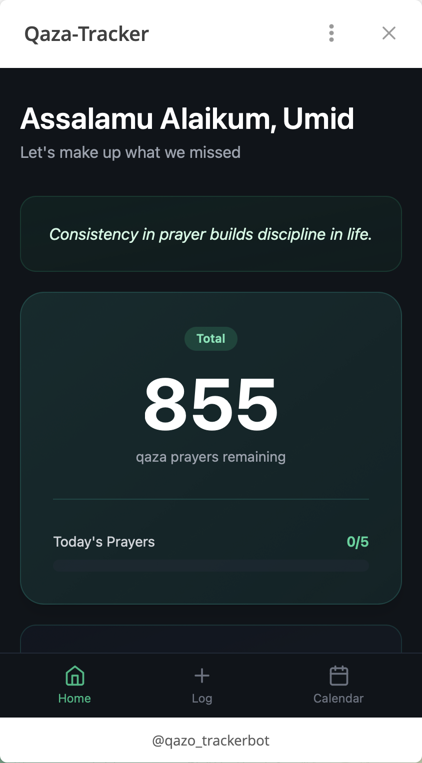
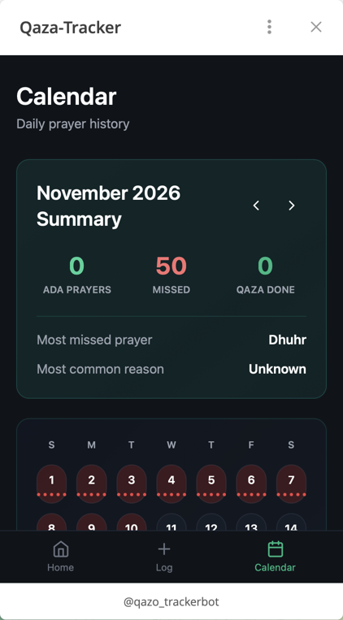
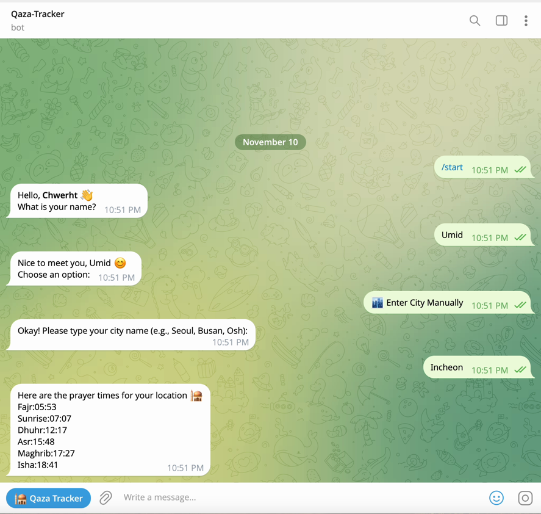

# 🕌 Qaza Tracker

A Telegram Mini App and bot that helps Muslims keep track of their missed prayers (*qaza*), remind them of prayer times, and pay the missed prayers back over time. **Used by 12 real people.**

**Try it:** [@qazo_trackerbot](https://t.me/qazo_trackerbot) on Telegram. Open the bot, send `/start`, and tap the app button.

It works in **English, Uzbek and Russian** and picks the language from the user's Telegram settings.

<p align="center">
  
  
  
</p>

*Mini App (Home, Calendar) and the bot's first-run setup: name, city, then that city's prayer times. [Watch the 23-second walkthrough](docs/demo.gif)*

---

## About the project

| | |
|---|---|
| **Problem** | Many people miss prayers and then lose count of how many they still owe. Paper notes and memory do not work for a number that keeps changing. |
| **What it does** | The bot announces each prayer time and warns you 10 minutes before a prayer's time runs out, with an "I prayed" button. If you do not answer, it records the prayer as missed automatically. The Mini App shows how many you owe, a breakdown by prayer, weekly activity and a calendar, and lets you log or clear prayers. |
| **Input** | The user's city or location, taps on the "I prayed" button, and prayers logged in the app. Prayer times come from the Aladhan API (Hanafi school), and the city is turned into coordinates with OpenStreetMap. |
| **Output** | Prayer time reminders, a running count of missed prayers, stats and a calendar. |
| **Users** | **12 real users**, in 3 languages. |
| **My role** | Solo: product idea, design, frontend, backend, bot, database, deployment, translations. |
| **Duration** | About 1 month, from scratch. |
| **Stack** | React + TypeScript + Vite + Tailwind (Mini App), FastAPI (API), aiogram (bot), Supabase PostgreSQL, Vercel, Railway |

---

## Architecture

```
                    ┌──────────────────────┐
  Telegram user ───►│ Telegram Mini App    │  frontend/  (React, Vercel)
                    └──────────┬───────────┘
                               │ HTTPS
                    ┌──────────▼───────────┐
                    │ REST API             │  backend/   (FastAPI, Vercel serverless)
                    └──────────┬───────────┘
                               │
                    ┌──────────▼───────────┐
                    │ Supabase PostgreSQL  │
                    └──────────▲───────────┘
                               │
                    ┌──────────┴───────────┐
  Telegram user ───►│ Telegram bot         │  telegram_bot/  (aiogram, Railway)
                    │ prayer-time schedulers│
                    └──────────────────────┘
```

- **`frontend/`**: the Mini App. It runs inside Telegram and reads the user's Telegram ID from the Telegram WebApp SDK. Pages: Home, Log, Calendar.
- **`backend/`**: a FastAPI REST API (totals, breakdown, stats, weekly activity, calendar, quotes, log prayers, mark as prayed), deployed as a Vercel serverless function. Every user route checks Telegram's signed login data, so users only reach their own data.
- **`telegram_bot/`**: an always-on bot. Every user gets their own scheduler tasks: a message at each prayer time, and a warning 10 minutes before each prayer's deadline (for example, Fajr ends at sunrise) with an "I prayed" button. If there is no answer within 2 hours, the prayer is recorded as *missed* and the message is deleted. There is also a reminder for Isha at 22:00. The user's time zone is found from their location.
- **Supabase** stores users, prayer logs and missed prayers. The bot talks to it directly, and the Mini App talks to it through the API.

---

## 🧩 Problems I hit and how I solved them

**1. One of the reminders was silently lost (Asr under-detection).**
The bot remembered only one pending reminder per user. When a second reminder came before the first was answered, it overwrote the first and that prayer was never marked as missed. I changed it to track pending reminders **per message**, so several can wait at once.

**2. Random `ConnectionTerminated` errors from the database.**
With many scheduler tasks running at once, the Supabase client's HTTP/2 connections kept getting terminated. I forced HTTP/1.1, and the errors stopped.

**3. The bot crashed on startup with `Illegal header value`.**
A hidden trailing newline in the `SUPABASE_KEY` environment variable broke the request header. I now strip whitespace from every environment variable in the bot and the backend.

**4. Deployments failed on dependency versions.**
`pydantic-core` had no ready-made build for Python 3.13, which forced a failing source build, and pip kept backtracking against Supabase versions. I pinned Python 3.12 and `pydantic==2.5.3`.

**5. Translation quality in Uzbek and Russian.**
My first translations had awkward phrasing and wrong spelling in the greeting. I corrected the orthography, made the bot and the Mini App use the same greeting, and fixed a bug where quotes were not filtered by the user's language.

**6. Simplifying the product as I used it.**
I merged the Profile page into Home, removed stat chips that were not useful, removed the free-text "Other" reason (it is now just "Others"), and log automatically detected missed prayers with the reason "Unknown" instead of a made-up one.

**7. The API trusted whatever user id it was given.**
Routes like `/total/{userId}` returned data for any id in the URL, so a stranger who guessed a Telegram id could read or change that person's prayers. I added Telegram's signed `initData` check on the backend: the Mini App sends it with every call, the backend recomputes the signature with the bot token, rejects stale data, and only allows a user to touch their own data. It has 14 tests, and I rolled it out in a log-only mode first (log what would be blocked, check real traffic, then enforce).

**8. Shared code in two services.**
The bot and the API use the same database queries. I documented this in each folder so a schema change is made in both places.

---

## Repository layout

```
├── frontend/       # React + Vite Mini App       → deploy on Vercel
├── backend/        # FastAPI API                  → deploy on Vercel
└── telegram_bot/   # aiogram bot                  → deploy on Railway
```

Each folder has its own README with setup steps and its own `.env.example`.

### Deploying from this monorepo
| Folder | Host | Setting |
|---|---|---|
| `frontend/` | Vercel | Root Directory = `frontend` |
| `backend/` | Vercel | Root Directory = `backend` |
| `telegram_bot/` | Railway | Root Directory = `telegram_bot` (the config file is `/telegram_bot/railway.json`) |

---

## Run it locally

```bash
# API
cd backend && python -m venv venv && source venv/bin/activate
pip install -r requirements.txt
cp .env.example .env        # SUPABASE_URL, SUPABASE_KEY
uvicorn app.main:app --reload

# Mini App
cd frontend && npm install
cp .env.example .env        # VITE_API_URL
npm run dev                 # needs Telegram's signed login data, so open the Mini App from the bot

# Bot
cd telegram_bot && python -m venv venv && source venv/bin/activate
pip install -r requirements.txt
cp .env.example .env        # TELEGRAM_TOKEN, SUPABASE_URL, SUPABASE_KEY
python -m bot.tg_bot
```

---

## Next steps

- Share the database code between the API and the bot instead of keeping two copies.
- Add automated tests for the reminder logic and the other API routes (the authentication already has tests).
- Add reminders for more time zones and calculation methods.
